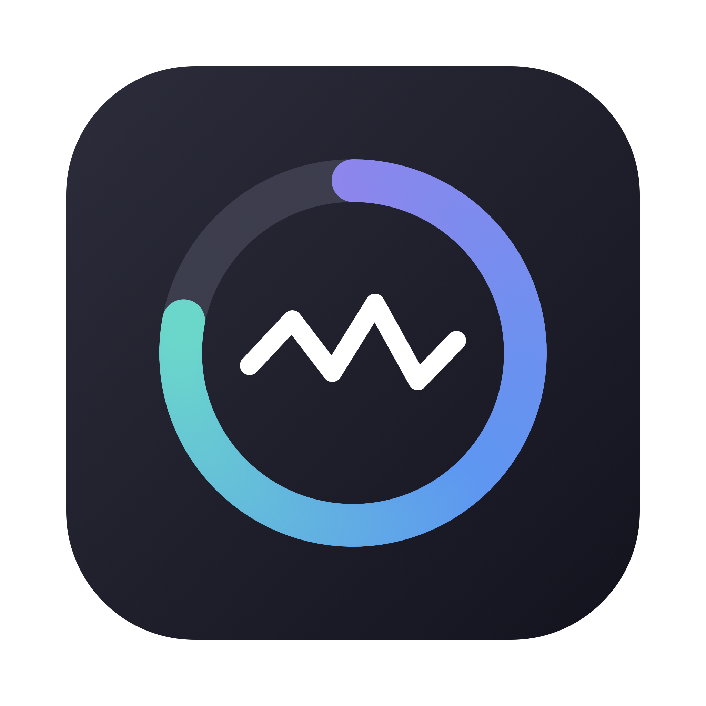
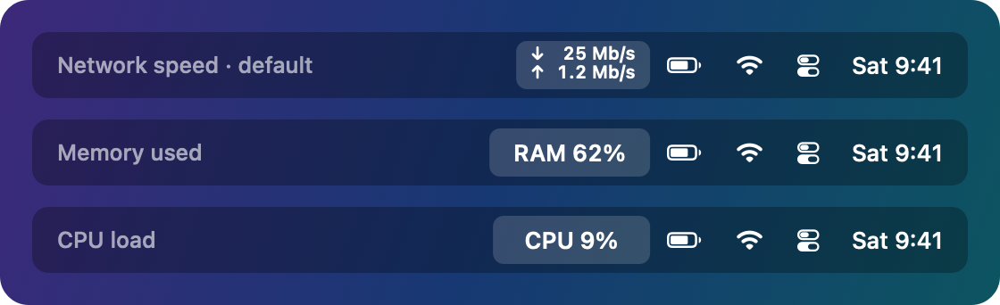
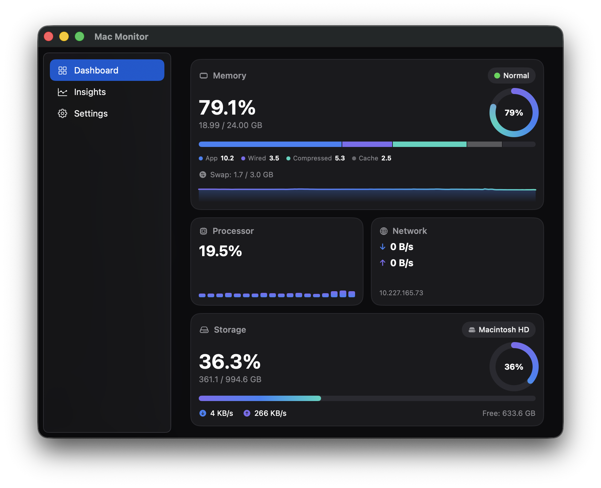
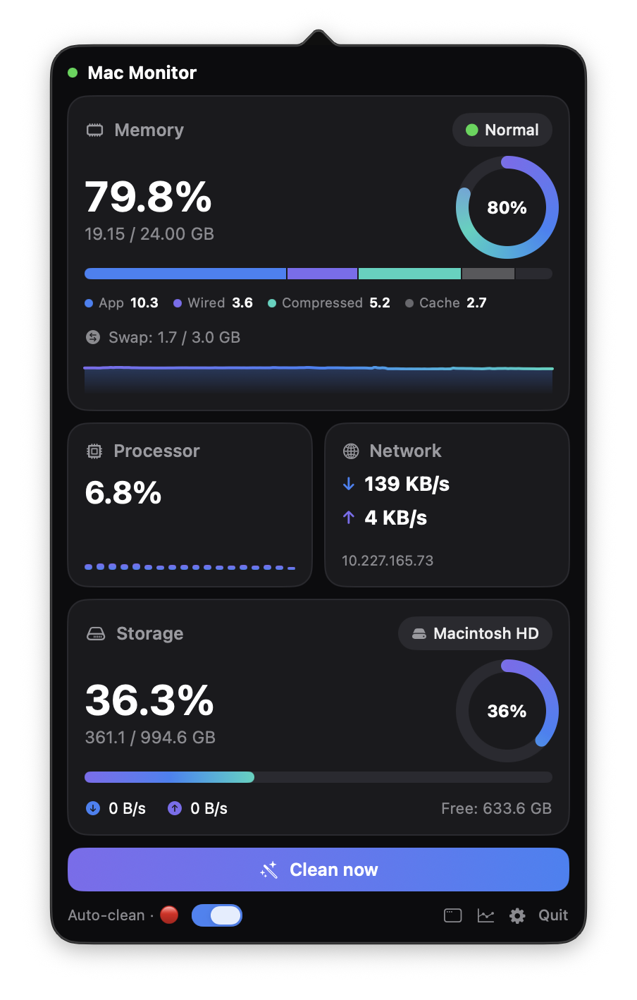
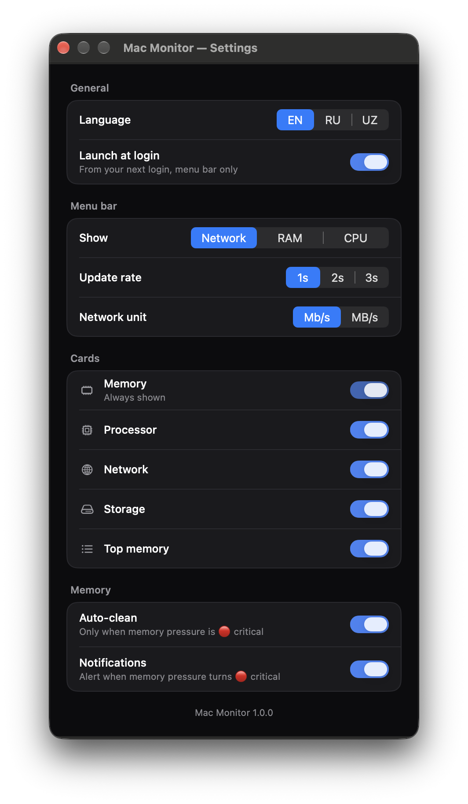
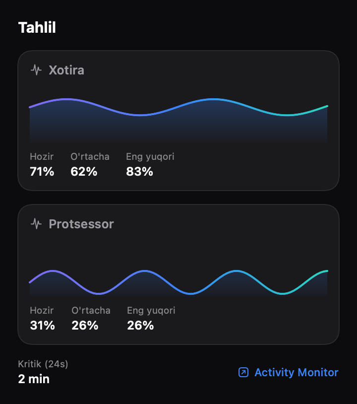

<div align="center">



# Mac Monitor

**A lightweight macOS menu-bar system monitor: RAM · CPU · Network · Disk.**

Live stats in your menu bar, a compact dashboard popover, history charts and a full
window mode. Native SwiftUI + AppKit, no third-party dependencies, no network access.

[](https://github.com/Ahmadjondev/MacMonitor/actions/workflows/build.yml)
[](https://github.com/Ahmadjondev/MacMonitor/releases/latest)


[](LICENSE)

[**Download the latest DMG**](https://github.com/Ahmadjondev/MacMonitor/releases/latest/download/MacMonitor.dmg)

<sub>Free and open source. If Mac Monitor is useful to you, a ⭐ helps other Mac users find it.</sub>

</div>

---

## Screenshots

<div align="center">
  
</div>

<div align="center"><sub>Menu bar: network speed (default), RAM % or CPU %</sub></div>

<br />

<div align="center">
  
</div>

<div align="center"><sub>Full window</sub></div>

<br />

<div align="center">
  
  &nbsp;&nbsp;
  
</div>

<div align="center"><sub>Menu-bar dashboard · Settings</sub></div>

<br />

<div align="center">
  
</div>

<div align="center"><sub>Insights</sub></div>

## What it is

Mac Monitor sits in your menu bar and shows one live number: internet speed by default,
or RAM % / CPU %. Click it for a dashboard of memory, processor, network and storage.
Open the full window for more detail, battery and GPU stats, and history charts.

It can also free inactive memory with macOS's `purge`, but **only when it actually
helps**. On macOS, low "free RAM" is normal: the system uses idle memory as disk cache.
The metric that matters is **memory pressure**. Mac Monitor never purges on a blind
timer. It cleans when you ask, or (if you opt in) automatically only while pressure is
critical.

## How it compares

There are great monitors already. Mac Monitor aims to be the small, focused one.

| | Mac Monitor | [Stats](https://github.com/exelban/stats) | iStat Menus |
|---|---|---|---|
| Price | Free, MIT | Free, MIT | Paid |
| Menu bar | One fixed-width number (net / RAM / CPU) | Many modules, highly configurable | Many modules |
| Focus | Memory pressure, with optional pressure-aware `purge` | Broad hardware sensors | Broad hardware sensors |
| Network access | None, by design | Update checks | Update checks |

If you want every sensor and fan speed, use Stats or iStat Menus. If you want one quiet
number in the menu bar and an honest answer to *"is my Mac actually out of memory?"*,
try Mac Monitor.

## Features

**Menu bar**
- Live download/upload speed on two compact lines, or RAM % or CPU %. Your choice.
- Narrow and fixed-width, so neighbouring menu-bar icons never jitter. Crisp on Retina,
  follows light and dark menu bars.
- Updates every 1, 2 or 3 seconds. Network speed in Mb/s or MB/s.

**Dashboard popover**
- **Memory:** used % and GB, donut ring, pressure pill (green / yellow / red),
  composition bar (App / Wired / Compressed / Cached), swap usage, and a memory-pressure
  graph colored like Activity Monitor's.
- **Processor:** total CPU % and a usage bar for every core.
- **Network:** live ↓/↑ speed, cumulative totals, local IPv4 address.
- **Storage:** used % and GB of the startup volume, live disk read/write throughput,
  free space.
- **Top apps:** the five biggest memory users, with helper processes grouped under
  their app.
- **Clean now** button, auto-clean switch, and shortcuts to Insights, the full window
  and Settings.

**Full window** (sidebar: Dashboard · Insights · Settings)
- Everything in the popover plus extra detail: CPU user/system/idle split, load
  average, process and thread counts; network packets and per-interface totals; disk
  IOPS and bytes read/written this session.
- **Battery:** charge, charging state, time remaining, health, cycle count,
  temperature, power draw, voltage, adapter wattage (Macs with a battery).
- **GPU:** utilization (when the GPU exposes it).

**Insights**
- RAM and CPU area charts with *now / average / peak*.
- Minutes of critical memory pressure over the last 24 h.
- History is kept as 1-minute aggregates and survives restarts.
- One click to open Activity Monitor.

**Everything else**
- **Memory cleaning:** on demand, or auto-clean only at critical pressure (max once
  per minute, off by default).
- **Notifications** when memory pressure turns critical (optional, max once per 5 min).
- **Three languages:** English, Русский, Oʻzbek, switchable live without relaunching.
- **Customizable:** show or hide each card; launch at login.
- **Lightweight:** about 1% CPU and ~50 MB of memory in normal use. Slow readings run
  off the main thread, and nothing renders while it's off screen.
- Universal binary (Apple Silicon + Intel), macOS 13 Ventura or later.

## Install

### Download the DMG

1. Download [`MacMonitor.dmg`](https://github.com/Ahmadjondev/MacMonitor/releases/latest/download/MacMonitor.dmg)
   from the [latest release](https://github.com/Ahmadjondev/MacMonitor/releases/latest).
2. Open it and drag **Mac Monitor** onto **Applications**.
3. Open **Mac Monitor** from Applications. A welcome window lets you pick a language
   and turn on notifications and launch at login. The app then lives in your menu bar.

### First launch: approving an unsigned app

The release is ad-hoc signed but **not notarized** (notarization needs a paid Apple
Developer ID). macOS will block the first launch with a message like *"Mac Monitor"
cannot be opened* or *Apple could not verify "Mac Monitor"*. Approve it once:

- **macOS 15 Sequoia and later:** open the app once and dismiss the warning. Go to
  **System Settings → Privacy & Security**, scroll down, click **Open Anyway** next to
  the Mac Monitor message, and confirm with your password.
- **macOS 13 Ventura / 14 Sonoma:** in Finder, **right-click (or Control-click) Mac
  Monitor → Open**, then click **Open** in the dialog.

Alternatively, remove the quarantine flag from Terminal:

```bash
xattr -dr com.apple.quarantine "/Applications/Mac Monitor.app"
```

You only need to do this once. If you'd rather not trust a binary, [build it from
source](#build-from-source). It takes about a minute.

### Homebrew

This repository is also a Homebrew tap:

```bash
brew tap ahmadjondev/macmonitor https://github.com/Ahmadjondev/MacMonitor
brew install --cask mac-monitor
```

The same first-launch approval applies.

### Uninstall

Quit Mac Monitor, then:

```bash
rm -rf "/Applications/Mac Monitor.app"
rm -f  ~/Library/LaunchAgents/app.macmonitor.MacMonitor.plist    # launch-at-login entry
rm -rf ~/Library/Application\ Support/MacMonitor                 # history
defaults delete app.macmonitor.MacMonitor 2>/dev/null            # settings
sudo rm -f /etc/sudoers.d/macmonitor                             # only if you added it
```

## Build from source

Requirements: macOS 13+ and the Xcode Command Line Tools (`xcode-select --install`),
which provide `swiftc`. No Xcode project, no packages.

```bash
git clone https://github.com/Ahmadjondev/MacMonitor.git
cd MacMonitor
./build.sh                          # → /Applications/Mac Monitor.app
open "/Applications/Mac Monitor.app"
```

`build.sh` compiles `Sources/*.swift` for arm64 and x86_64 (macOS 13 deployment
target), merges them with `lipo`, assembles the `.app` bundle with `Info.plist` and the
icon, and ad-hoc signs it. To build somewhere else:
`APP="$PWD/build/Mac Monitor.app" ./build.sh`.

To build the drag-to-install DMG: `scripts/release.sh` → `dist/MacMonitor.dmg`.

## How it works

Everything is read locally from public macOS APIs once per tick (1–3 s). Speeds and
percentages are deltas of cumulative kernel counters over elapsed time.

| Number | Source |
|---|---|
| Memory used, App / Wired / Compressed / Cached | Mach `host_statistics64(HOST_VM_INFO64)` page counts × page size. Used = (internal − purgeable) + wired + compressed, close to Activity Monitor's "Memory Used". |
| Total RAM | `sysctl hw.memsize` |
| Swap | `sysctl vm.swapusage` |
| Memory pressure | `sysctl kern.memorystatus_vm_pressure_level` (1 normal · 2 warning · 4 critical) |
| CPU % (and user / system / idle) | Mach `host_statistics(HOST_CPU_LOAD_INFO)` tick deltas |
| Per-core CPU | Mach `host_processor_info(PROCESSOR_CPU_LOAD_INFO)` tick deltas |
| Load average | `getloadavg` |
| Processes / threads | libproc `proc_listpids` + `proc_pidinfo(PROC_PIDTASKINFO)` |
| Network speed, totals, packets, per interface | `getifaddrs` link-layer `if_data` byte and packet counters, all non-loopback interfaces |
| Local IP | `getifaddrs` IPv4 address on `en*`, preferring `en0` |
| Disk capacity | `URLResourceValues` of `/`: total and "available for important usage" (decimal GB, like Finder) |
| Disk read/write, IOPS | IOKit `IOBlockStorageDriver` → `Statistics` (bytes and operations read/written) |
| Battery | IOKit power sources (`IOPSCopyPowerSourcesInfo`) + `AppleSmartBattery` registry |
| GPU | IOKit `IOAccelerator` → `PerformanceStatistics` utilization |
| Top apps | `/bin/ps -axo rss=,comm=`, summed per app. Runs only while the dashboard is visible. |

Heavier readings (top apps, thread counts, per-interface stats, battery, GPU) run only
while the window that shows them is open, to save power.

**History.** The last ~3 minutes of raw samples are kept in memory for live charts.
Every minute they are averaged (pressure keeps its maximum) into one aggregate. The
last 1,440 aggregates (24 h) are saved to
`~/Library/Application Support/MacMonitor/history.json`, so Insights survives restarts.

**Menu bar + window (hybrid model).** The app is a menu-bar agent (`LSUIElement`, no
Dock icon). When you open the full window it temporarily becomes a regular app with a
Dock icon and menu bar. Closing the window returns it to menu-bar-only. Opening the app
from Finder, Launchpad, Spotlight or the Dock shows the window.

**Launch at login.** The toggle writes a per-user LaunchAgent at
`~/Library/LaunchAgents/app.macmonitor.MacMonitor.plist` (`RunAtLoad`) that starts the
app with `--menubar`, so it starts quietly in the menu bar without opening a window.
Turning it off deletes the file. Toggling never restarts the running app; changes apply
at the next login.

See [docs/ARCHITECTURE.md](docs/ARCHITECTURE.md) for the full breakdown.

## Optional: silent memory cleaning

`purge` requires root. Without any setup, **Clean now** shows the standard macOS
administrator password prompt, and auto-clean is skipped, because it never asks for a
password in the background.

To let the app run `purge` without a prompt, add a sudoers rule that allows exactly one
command:

```bash
echo "$(whoami) ALL=(root) NOPASSWD: /usr/sbin/purge" | sudo tee /etc/sudoers.d/macmonitor >/dev/null
sudo chmod 440 /etc/sudoers.d/macmonitor
sudo visudo -cf /etc/sudoers.d/macmonitor     # syntax check
```

Why this is narrowly scoped:
- It grants passwordless root to **one absolute path**, `/usr/sbin/purge`, a
  system binary protected by System Integrity Protection, which takes no arguments.
  No other command is allowed.
- It applies only to your user account, and the app calls exactly
  `sudo -n /usr/sbin/purge`.
- `purge` only flushes the file cache. It can't read data or change settings. The worst
  a misuse can do is make the next few seconds of disk access slower.
- Remove it at any time with `sudo rm /etc/sudoers.d/macmonitor`.

If auto-clean is on but the rule is missing, Settings shows a warning under the switch.

## Privacy

Mac Monitor **makes no network connections**. The source contains no networking code:
no URLSession, no sockets, no analytics, crash reporting, update checks or telemetry.
The network numbers come from reading your Mac's own interface counters, not from
contacting any server.

What it stores, all locally in your user account:
- settings in `UserDefaults` (`app.macmonitor.MacMonitor`);
- metric history (percentages and speeds only) in
  `~/Library/Application Support/MacMonitor/history.json`;
- the LaunchAgent plist, only if you enable launch at login.

What it runs: `/bin/ps` (to list top memory users while the dashboard is open),
`/usr/sbin/purge` via `sudo` or an admin prompt (only when cleaning),
`sudo -n -l /usr/sbin/purge` (when Settings opens, to check whether the optional sudoers
rule exists; it runs nothing), and Activity Monitor (only when you click its button). Process names are shown on screen and never
saved.

## Why isn't it on the Mac App Store?

App Store apps must run in the App Sandbox, which blocks the things this app is for:
running `purge` with administrator rights, listing every process with `ps`, and writing
a LaunchAgent for launch at login. Most full-featured macOS system monitors are
distributed outside the store for the same reason.

## Project structure

```
Sources/
  main.swift          App delegate: menu-bar item, popover, windows, sampling timer, purge/notification triggers, LaunchAgent
  Core.swift          Core readings (memory, pressure, network, disk, top apps, purge), app state, settings, dashboard cards and views
  Advanced.swift      Window-only readings: load average, processes/threads, packets/per-interface, battery, GPU
  History.swift       Rolling samples + 24 h of 1-minute aggregates persisted to history.json
  Insights.swift      History charts and now / average / peak stats
  MainWindow.swift    Full window: sidebar navigation (Dashboard / Insights / Settings)
  Welcome.swift       First-launch onboarding (language, notifications, launch at login)
  Localization.swift  English / Russian / Uzbek string table with live switching
tools/                Preview renderers (views → PNG), DMG background and geometry helpers
Resources/            App icon (generator, PNG, .icns)
scripts/              compile.sh (universal build), release.sh (DMG), notarize.sh (signed release template)
Casks/                Homebrew cask
docs/                 ARCHITECTURE.md (developer notes)
build.sh              Build and install the .app
```

## Contributing

Bug reports, feature ideas, translations and pull requests are welcome. Adding a new
language is a good first contribution: it's a single string table in `Localization.swift`. See
[CONTRIBUTING.md](CONTRIBUTING.md) for build steps, code style and how to add a language.
Changes are listed in [CHANGELOG.md](CHANGELOG.md).

## License

[MIT](LICENSE) © 2026 Ahmadjondev
